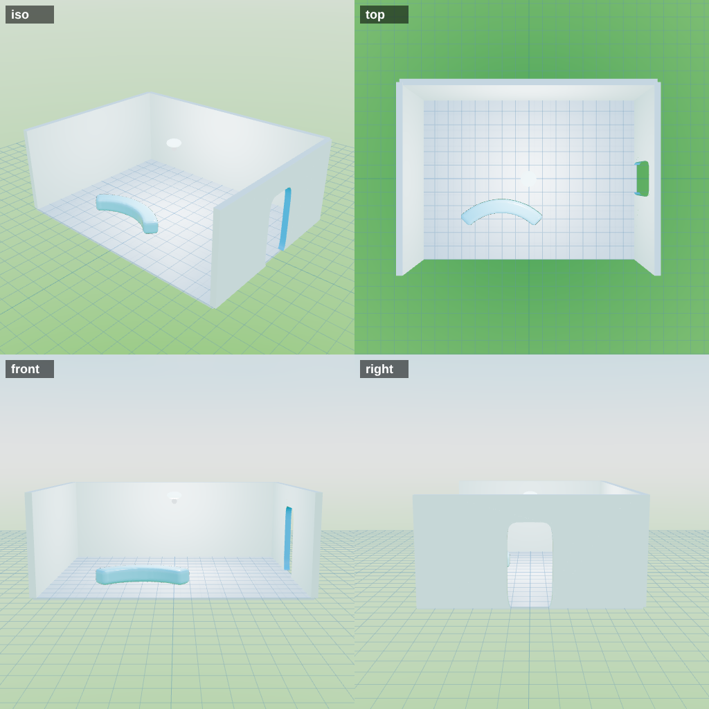

# Meshtype

**v0.7.2.** A tiny browser mesh editor for squircles and glossy Frutiger Aero shapes. Solid and cutter parts, UNION / NEGATE / SPLIT, edge rounding, SVG extrusion, multi-select, and GLB export. No build step. Installable as an app and works offline.

Made because Blender is overkill when all you need is a rounded panel with a dent in it.

## Run it

It uses ES modules, so double-clicking `index.html` won't work in most browsers. Serve the folder:

```sh
python -m http.server 8000
# then open http://localhost:8000
```

Or push it to GitHub Pages as-is. Everything it needs is in this repo, including the libraries (`vendor/`).

**Install it:** in Chrome or Edge use the install button in the address bar (or the Install app button in Meshtype's title bar). After the first load it runs fully offline.

## For agents (Claude, Astra): build rooms from JSON

Rooms are plain JSON, so an agent can write one and the CLI bakes it, no clicking:

```sh
npm install && npx playwright install chromium     # once
node tools/meshtype.mjs check rooms/hall-a.meshtype.json
node tools/meshtype.mjs build rooms/hall-a.meshtype.json --out ../game/assets/rooms
```

`build` writes `hall-a.glb`, `hall-a.room.json` and `hall-a.preview.png` (four views to look at before committing). `check` lists errors and warnings (empty unions, cutters doing nothing, floors overlapping, parts sunk into the floor, bad params...). The format is in **[docs/FORMAT.md](docs/FORMAT.md)**, the workflow and room conventions in **[docs/AGENTS.md](docs/AGENTS.md)**, and a working example in `examples/hall-a.meshtype.json`. The editor's Open loads the same files, so any agent-built room can be tweaked by hand.



## Shapes

**Add shape** drops a primitive into the scene:

- **Box** and **Wall**: sharp, 12 triangles, sitting on the floor. Use them for room shells and anything whose edges you never see. A Wall starts at 4 × 3 × 0.2 m.
  - **Curve angle** bends a Box or Wall along its whole length, around the vertical axis. The two ends always end up exactly that many degrees apart, however long, tall or thick it is: 90° is a quarter-turn hallway wall, 180° a U, 360° a ring. Negative angles curve the other way. Resize it as usual and the curve keeps its angle. At 0° it is back to a plain 12-triangle box.
- **Block, Panel, Disc, Orb**: squircles with two sliders. *Outline n* shapes the top view, *Edge n* the side profile (2 = round, 4 = classic squircle, 20 = nearly a box).
- **Pill**, **SVG** (extrude an SVG), **Light** and **Spot**.

**Change shape** (in the inspector) swaps a part's shape (Box, Block, Panel, Disc, Orb, Pill) and keeps its size, place, rotation and material. With several things selected it changes all of them, and the material, color and texture controls apply to the whole selection too.

## Building rooms

Meshtype doubles as a room blockout tool for Godot: build a room on a baseplate, export it as one GLB, and drop it into the game like a Lego piece.

- **Floors** are their own layer: normal clicks, box select and drags never grab them, so you can't knock one out of place by accident. To edit them, press **B** (or Floor ▾ → Edit floors) to enter **Floor mode**: parts lock, the status bar turns yellow, and you can click a floor, slide it by dragging, or use the gizmo (1 move, 2 turn around Y, 3 resize). Scale (3) shows the same corner/edge handle box as parts: drag a side and the opposite side stays planted (or From center). Each floor can also take a **custom texture** (Image… in the inspector) with its own tile size in meters. The inspector lists every floor with its flooring (Aero carpet, Office tile, Glossy lab, Dark grid, Concrete), size, position and turn. **Add floor** parks the new one against the east edge of the existing floors. Floors that overlap get a red outline and a warning, so rooms don't clip into each other. Press B again (or Esc twice) to go back to parts. Floor ▾ → Show floors hides them all.
- **Grid**: 0.05, 0.25, 0.5, 1 or 2 m. With Snap on, moves snap to it. Keep every room on the same grid (1 m is a good default) so rooms line up when they are assembled.
- **Drag on the ground**: left-drag a shape to slide it (and the rest of the selection) across the floor. Its height stays the same; use the gizmo's up arrow to change height.
- **Godot collision** (next to Export): names every mesh with `-col`, so Godot's importer builds static collision for it automatically. Each floor exports as its own mesh, named after the floor.
- The GLB's root node is named after the project and carries `meshtype` info (grid size, floor count) in its glTF extras.

Units are meters on both sides, so a room exported here is to scale in Godot.

### Lights

**Light** and **Spot** (in Add shape, or right-click empty space) place real lights you can see in the viewport: color, brightness in candela, range, and for spots the cone angle and edge softness, plus a "casts shadows" flag. They export inside the GLB as glTF punctual lights, which Godot imports as `OmniLight3D` / `SpotLight3D`. Spots point along their local -Z; the yellow cone shows where.

### Tags

Every part, union and light can carry tags: `hall`, `door`, `archway`, `keycard`, `locked`, `spawn`, `trigger`, `alarm`, `camera`, `switch` and so on (or type your own, like `keycard:red`). With several things selected, a tag goes on all of them. Tags travel in the GLB (glTF extras on each node) and in the room JSON. Tag a part `no-collide` to export it without collision.

### Room JSON

With **Room JSON** ticked, Export GLB also downloads `room-name.room.json`. It lists every mesh and light by the exact node name used in the GLB (and the name Godot gives it after stripping `-col`), with its tags, transform, world bounds, material, light settings, the grid size and every floor (size, position, turn, flooring). It's meant for whoever assembles rooms in Godot (you, Claude, or Astra) to map nodes to scenes and scripts without guessing. Chrome may ask once to allow multiple downloads.

## Groups vs unions

**Group** (Ctrl+G, or the Group button under Combine) just puts things under one parent: click any of them and the whole group selects, moves, turns, mirrors and scales together, but every part stays its own mesh. It exports as a parent node with the parts as children, so Godot sees the same hierarchy. **Ungroup** (Ctrl+U) removes the parent. **UNION** is different: it merges the parts into one baked mesh and applies cutters.

## Sun and view

- **Sun** (☀ in the toolbar, or `L`): a visible yellow sun with a dashed line to the world center. Drag it with the gizmo to light the scene from anywhere; set color, strength and sky light (reflections and fill). Tick *Export as a DirectionalLight3D* to put it in the GLB.
- **View cube corners**: the small squares at each face's corners snap to the isometric view from that corner.
- **PERSP / ISO** (under the cube): isometric view, with almost no perspective.
- **ORBIT / POV** (under the cube): ORBIT circles around a point in front of you (F moves that point onto the selection). POV makes the pivot *you*: right-drag turns your head in place, WASD still flies, and the wheel moves the camera forward and back (Shift slow, Ctrl fast).

## The combine model

Every shape is either a **solid** or a **cutter** (shown in red). A cutter does nothing on its own. It only cuts when you UNION it with a solid.

| Button | What it does |
| --- | --- |
| **UNION** (`U`) | Blends the selected parts into one solid. Cutters in the selection are subtracted. Two cubes become clearly one part. |
| **NEGATE** (`N`) | Flips the selection between solid and cutter. |
| **SPLIT** (`X`) | Takes a union apart into its separate parts. Each part keeps its solid/cutter state. With nothing selected it splits every union. |
| Intersect | Keeps only where the selected parts overlap. |

A union is one object: it bakes into a single new shape, so selecting it highlights the result, not the cutters inside. NEGATE a union to turn the whole baked shape into a cutter (shown as a red ghost) and union it with something else. The original parts are kept, so SPLIT can always take it back apart. Click it and the gizmo moves the whole thing. Click a part in the Parts list to edit that part alone (its shape, material, position). Unions can nest. Cut faces take the material of the cutter.

## Selecting

- **Click** a shape in the viewport or the Parts list.
- **Ctrl or Shift + click** to add or remove from the selection.
- **Alt + click** in the viewport picks the part inside a union.
- **Right-click** for the context menu: Union, Negate, Split, Center, Align, Duplicate, Hide, Rename, Frame, Select all, Delete. Right-click empty space to add shapes or import an SVG.

With several things selected the gizmo moves them together.

## Camera

| Key | Action |
| --- | --- |
| `W` `S` | Fly forward / back |
| `A` `D` | Strafe left / right |
| `E` `Q` | Up / down |
| `Shift` | Fine movement (held) |
| `Ctrl` | Fast movement (held) |

**Land on surfaces** (toolbar, on by default): dragging a shape rides it over whatever is under the cursor, Roblox-style. On a top face it sits on it, against a wall it presses flat to the wall, over nothing it drops to the ground. Turn it off to slide at the current height.

**Mouse:** right-drag orbits, middle-drag pans, the wheel zooms. Left-drag on a shape slides it along the ground; left-drag on empty space draws a selection box (an object is selected when at least 80% of it is inside the box; hold Shift or Ctrl to add). Right-click without dragging opens the menu.

**View cube** (top right of the viewport): click a face for that view, or drag it to orbit.

**Sky** (button in the viewport toolbar): the Aero sky, a solid color (swatches or any color), or your own equirectangular panorama (JPG or PNG, shrunk to 2048 px wide). The panorama can also drive the reflections on glass. Ctrl+W closes a browser tab and no page can stop that, but Meshtype asks for confirmation if you hit it while flying, so you don't lose work.

## Other shortcuts

| Key | Action |
| --- | --- |
| `1` `2` `3` | Move, Rotate, Scale |
| `R` / `T` | Quarter turn (90°) around Y / around Z |
| `O` | Toggle World / Local axes |
| `L` | Sun: drag the global light (Esc or L to finish) |
| `Ctrl+G` / `Ctrl+U` | Group / ungroup |
| `Ctrl+S` / `Ctrl+Shift+S` | Save / save as |
| `Ctrl+Alt+Shift+W` | Export GLB |
| `B` | Floor mode on/off |
| `F` | Focus the camera on the selection (everything if nothing is selected) |
| `C` | Duplicate |
| `Ctrl+C` / `Ctrl+X` / `Ctrl+V` | Copy / cut / paste. The clipboard survives switching projects and tabs, so you can copy pieces from one room into another. Pastes land exactly on top of the original; drag them off with the gizmo arrows. Works on floors in Floor mode too. |
| `Esc` | Deselect |
| `Delete` | Delete the selection |
| `Ctrl+Z` / `Ctrl+Y` | Undo / redo |
| `Ctrl+R` | Disabled, so you don't reload by accident (`Ctrl+Shift+R` still refreshes) |

## Scaling, turning and axes

**Scale mode (3)** shows a Tinkercad-style box around the selection instead of arrows:

- White **corner** handles (bottom) stretch width and depth together.
- Dark **edge** handles (bottom, middle of each side) stretch one direction.
- The white **top** handle changes the height.
- **From edge** (default): the opposite side stays planted, so the shape grows toward your drag. **From center**: it grows evenly both ways. Hold **Alt** to flip between the two while dragging.
- Hold **Shift** to keep proportions.
- With Snap on, sizes snap to the grid. The status bar shows width × height × depth while you drag.

One part scales in its own (rotated) frame, so a turned part stays clean. Several things (or a union) scale inside their shared world box: each part stretches along its own axes and keeps its rotation. If the selection contains a curved wall, it scales evenly (a stretched arc can't stay an arc).

**R** and **T** turn the selection a quarter turn around Y (spin on the floor) and Z (tip over), about the selection's center. Plain keys on purpose: browsers reserve Ctrl+T and no web page can take it.

**World / Local** (toolbar, or `O`) switches the move and rotate gizmos, and the R/T turns, between the world axes and the selected object's own axes. Scaling always uses the object's own axes; scaling a turned part along world axes would skew it, which a mesh like this can't store.

In Floor mode, floors keep the arrow gizmo; hold Ctrl while scaling a floor to pin its far edge. R turns the selected floor 90°.

## Center and Align

In the right panel under **Arrange**:

- **Center** moves the selection so its middle sits at world 0. Untick X, Y or Z to leave an axis alone.
- **Mirror X / Y / Z** flips the selection across its own center. A curved wall mirrored across its thickness flips its curve. SVG parts can only mirror across their thickness.
- **Distribute X / Y / Z** (3+ things) spaces them with equal gaps; the two outermost stay put.
- **Align**: click X, Y or Z and a blue plane shows where things will land. Choose which edge to align (Min, Center, Max) and what to align to (Average, the Active (last picked) item, Lowest, Highest, or World 0), then press Align. A union moves as one thing.

## Round edges

Select a finished solid or union and use **Round edges** in the right panel:

- **Outer edges** rounds convex corners and edges (where a surface bends away). Intersecting shapes usually leave sharp ones.
- **Inner edges** rounds concave corners (where two surfaces meet, or a cut ends).
- **Quality** is the voxel resolution. Higher is smoother and slower.
- **Sander** smooths away the faint ripples the voxel rebuild can leave on curved surfaces (default 3). The rounder also rebuilds each part at a much higher detail first, so the facets of a low-detail shape don't show up as bands.

A green progress bar in the status bar shows how far along it is.

It rebuilds the shape as a smooth mesh in a background worker, so the editor stays responsive. Exports use the rounded mesh. The rebuilt mesh is dense (tens of thousands of triangles), so use Low or Draft when the model is going into a game, and decimate if you need it lighter. Radius is in world units. If it is under about 1.5 voxels the result gets blocky, so raise Quality.

Rounding is applied to a top-level part or union. If you union a rounded part into something else, its round setting is cleared; round the finished union instead.

## SVG import

**SVG** in Add shape (or drag an `.svg` onto the viewport) extrudes it into a part. It is centered, scaled to 2 units on its longest side, and Y-up. Then use Extrude depth and Round edges to finish it.

- Filled shapes and paths work. Strokes are ignored, so convert strokes to filled paths first.
- Holes (even-odd or opposite winding) work.
- Overlapping filled shapes in the same SVG can leave internal faces that confuse booleans. Merge them in your SVG editor first.

## Materials and textures

The material list has two groups. **Godot-friendly** ones import into Godot exactly as they look here: Satin plastic, Rubber, Painted metal, Brushed steel, Mirror, Ceramic, Concrete, Wood (color), Clear acrylic and Tinted glass (see-through with plain transparency), Neon, Glow, Matte, Chrome. **Aero preview** ones (Aero glass, Gloss plastic, Bubble, Frosted glass) use glass refraction, clearcoat and iridescence that look great in Meshtype but Godot drops or simplifies on import; use Tinted glass or Clear acrylic for glass in the game.

Aero glass, Gloss plastic, Bubble, Frosted glass, Chrome, Matte, Glow. Pick one, then tint it. With a union selected, the material, tint and texture apply to every part in it.

**Texture**: Image… loads a picture (shrunk to 1024 px) and box-projects it onto the shape. Tile size sets how big one repeat is in world units. The tint multiplies the image, so set it to white to see the image colors as-is. It is a simple box projection, so expect seams where a surface turns between directions. Textures export with the GLB.

## Export

- **Export GLB** writes every visible solid with its materials (transmission, clearcoat, iridescence and so on, as glTF extensions).
- **Geometry only** exports plain white geometry with no materials. Use it when you want to build the materials yourself in Godot or Three.js. Transmission and iridescence don't import everywhere.
- **Export OBJ** exports geometry only.
- **Save / Open** use a `.meshtype.json` file (SVGs are embedded). The editor also autosaves to your browser's local storage.

Cutters alone export nothing. Units: 1 unit = 1 meter. Y is up.

## Layout

```
index.html              page, import map
style.css               the Windows 7 Aero skin
manifest.webmanifest    PWA manifest
sw.js                   service worker (network first, offline fallback)
precache.json           file list for the service worker (generated)
icons/                  app icons
src/main.js             editor: scene, parts, unions, UI, export
src/shapes.js           box, squircle + pill geometry generators
src/svg.js              SVG -> extruded geometry
src/rounder.js          edge rounder (signed distance field)
src/round-worker.js     runs the rounder off the main thread
src/materials.js        material presets + procedural sky
src/floor.js            baseplate flooring presets (procedural textures)
tools/                  meshtype.mjs (CLI), build-precache.mjs, make-icons.mjs
docs/                   FORMAT.md, AGENTS.md, rooms-workflow.yml
examples/               hall-a room (source, GLB, manifest, preview)
tests/                  rounder.test.mjs, e2e*.mjs (real-browser checks)
vendor/                 three.js, three-mesh-bvh, three-bvh-csg (see vendor/README.md)
```

## Deploying a change

The service worker caches the whole app. After you edit any file, regenerate the file list so returning users get the update:

```sh
node tools/build-precache.mjs
```

## Known limits (v0.7.2)

- Booleans are live, so keep Detail at 2 or 3 on dense scenes.
- Scaling a rotated part from a multi-selection gizmo can introduce shear, which Meshtype can't store. Use Scale on single parts for that.
- Very thin features can misbehave in booleans (a general CSG limit). If you see a sliver, nudge the cutter a little.
- Round edges is global to the unit and produces a dense mesh. It can't round just one edge.
- No sculpting or per-vertex editing. Meshtype is a generator and combiner, not a modeler.
- Projects from v0.1.0 open as one union (cutters become red parts). Intersect layers become plain parts.

## Tests

```sh
node tests/rounder.test.mjs     # fillet volume matches the analytic answer
node tests/e2e.mjs              # real-browser check (needs Playwright); serve the repo on :8123 first
```

## Credits

- Default desktop wallpaper: **"Longhorn Bliss"** by [yethzart](https://www.deviantart.com/yethzart), from stock photos via sxc.hu. Licensed [CC BY-NC-ND 3.0](https://creativecommons.org/licenses/by-nc-nd/3.0/): included unmodified, with credit, for non-commercial use only. If Meshtype ever goes commercial, swap it out. Set your own under Sky ▾ → Desktop wallpaper.
- Libraries: see `vendor/README.md`.
